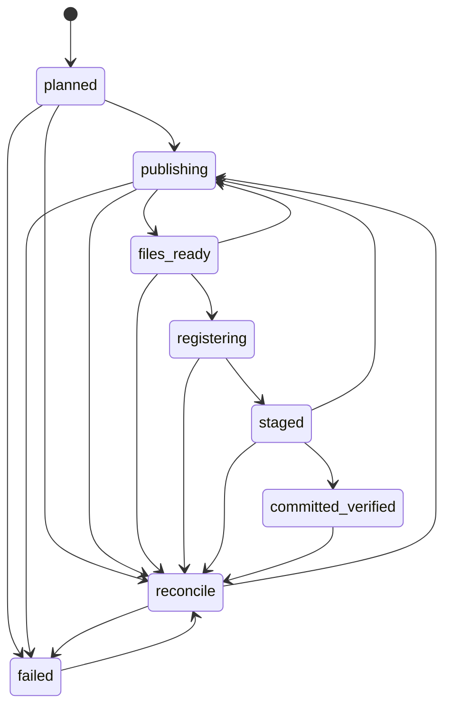

# S2C-03 durable operations — local review gate

Baseline: `main` / `origin/main` at
`2c2f9648b0f751af40495aaefef2b4dfde4111c9`. Work is on
`feature/s2c03-durable-operations`. At the local implementation gate it was
uncommitted and unpublished. The subsequent publication request authorizes one
reviewed feature-branch commit and push for independent code review. No development
database connection or migration was made. No real storage root is configured,
and no student documents, identifiers or research directories were accessed.

## Implemented scope and schema

A journal operation records engineering work before a dataset snapshot exists.
It is distinct from the approved S2A analytical `ExperimentRun`, which still
requires a genuine snapshot. No snapshot is fabricated, and no scientific method
is executed. The service accepts only complete, explicit synthetic P1 inventories;
P2/D1 scientific ownership extensions remain proposals. One database per
environment remains the architecture.

The proposed additive revision is `s2c03_0001`, following `s2b01_0001`:

| New table | Purpose |
|---|---|
| `operation_study` | Opaque study UUID, P1/P2/D1 code, version and provenance FK |
| `operation_corpus` | Explicit corpus ownership; one study per corpus; composite FK target |
| `research_operation` | Immutable request identity, unique study/idempotency UUID, canonical full request digest, optional corpus, type/version, method/parameter/configuration UUIDs, provenance, complete S2A reproducibility evidence and creation time |
| `operation_object` | Declared input/output UUID/hash/version/provenance references; declaration alone does not prove publication |
| `operation_event` | Append-only numbered status history, predecessor FK, allowed transition CHECK, timestamp and fixed failure indicator |
| `operation_dependency` | Same-study operation dependencies with composite FKs and self-dependency rejection |
| `operation_experiment_link` | Optional later link to an actual analytical experiment; no experiment is created here |

There are 22 research/journal tables plus `alembic_version` after the proposed
upgrade. All original 15 tables and five task definitions are preserved. Existing
`models.Base` remains exactly 15 tables; the new module copies reference metadata
into separate combined metadata for migration comparisons, without mutating the
approved mappings. The migration freezes DDL and does not import live model code.

Columns contain metadata only: no JSON request blob, source text, filenames,
physical roots, credentials or arbitrary error messages. Current service object
records are publication outputs; the direction column permits future reviewed
input-reference adapters. Request reconstruction still needs the private complete
manifest and artificial bytes. The database digest is not a substitute for them.

The service writes requests and events by INSERT only. CHECKs/FKs enforce state
names, predecessor chains, digests, ownership and uniqueness. SQL timestamps,
dependency readiness, matching repeated object metadata, later experiment
compatibility and immutability still need trusted service/role enforcement.
There are no sealing triggers, production ACL provisioning or RLS here. A role
with unrestricted UPDATE/DELETE can alter history; append-only service behavior
must not be described as database-enforced immutability.

## State machine and commit boundaries

`DurableRequest` pins the existing immutable execution plan, complete validated
registration manifest and idempotency UUID. The canonical digest includes the
inventory, publication metadata, dependencies and all supplied evidence. A
different request cannot reuse an operation UUID or study/idempotency pair.
Reruns use new identities. Dependencies must already have verified committed
status in the same study before planning; this prevents introducing cycles via
new requests. Dependency invalidation/revocation remains future work.

`DurableSyntheticRunner.stage(connection, workspace, request, plans)` requires an
existing isolated test transaction. It uses a savepoint and returns **staged**,
never a new committed claim. A failure rolls back SQL additions/history within
that savepoint; verified files may remain. An outer rollback can remove all
journal rows, so re-entry recreates the exact request after checking the files.
A repeated intact staged request verifies actual rows/files without adding events.

`execute(engine, ...)` is an explicit own-transaction API, restricted to loopback
`stylometry_test` before connecting. It commits planned/publishing journal records,
then publishes and verifies files and commits staged metadata. After that commit
returns, it checks actual journal/object/research rows and hashes via a new engine
connection, appends `committed_verified`, and commits that verification event.
It returns success only after this last commit returns. A lost acknowledgement
is uncertain: best-effort `reconcile` marking never assumes rollback. An identical
retry checks actual state and completes verification; conflicting data fails.

A cooperative PostgreSQL transaction advisory lock serializes journal requests;
unique identities and predecessor constraints provide further conflict checks.
Files use separate cross-process exclusive-create locks. These are two resources,
not a distributed atomic transaction. A valid file does not prove SQL commit, and
a savepoint does not prove outer commit. Scientific dispatchers remain unavailable;
the durable adapter reuses only the synthetic inventory runner. Its dependency-free
in-memory computation adapter does not replace the original pinned SQL request.

## Private restart recovery

`RecoverableSyntheticWorkspace` extends the unchanged S2C-02 publisher. It creates
a new internally allocated OS temporary directory outside Git. There is no live
root/path parameter, import API or use of `STYLOMETRY_PRIVATE_ROOT`.

`create_workspace(request, authorizer=..., caller=...)` returns an active workspace.
The caller must close it in `finally`, or explicitly `detach()` to retain it across
processes. A private `RecoveryDescriptor` is a bearer capability: save its JSON
only in approved private local storage outside Git. Its representation suppresses
values, but serialization intentionally reveals private recovery evidence and
must never be logged, stored in SQL or sent externally. No automatic descriptor
backup or production secret-storage service is implemented.

`reopen_workspace(descriptor, identical_request, ...)` derives only a constrained
synthetic temporary basename. It verifies the fixed local parent, directory
device/inode, random ownership marker, full immutable recovery record, operation
UUID, complete request hash and publication identities. It cannot attach to an
arbitrary directory or a configured research root. The separate descriptor and
matching on-disk evidence must both survive. Lost or conflicting evidence fails
closed; this is not a directory discovery/scanning mechanism.

The old reader still defaults to deny. Recovery does not supply an allow policy;
tests use an explicitly artificial capability policy, which is not authentication.
Native Windows handles pin no-reparse ancestors; payloads stay exclusive-created,
single-link, UUID addressed and hash verified. Completed objects are never repaired
or overwritten on retry. Catalog changes retain prior entries. Ambiguous duplicate
JSON keys, changed markers, unknown object entries, conflicting ledgers, corrupt
catalogs and missing/corrupted published payloads fail closed with fixed errors.

Locks contain a private owner token, manifest digest, PID and Windows process
creation time. They are never stolen automatically. After proving the original
process incarnation has exited, the operator can call
`release_abandoned_lock('writer.lock')` or `'registration.lock'`. Access-denied,
unknown, malformed or live-owner evidence is refused. Explicit release is serialized
by `recovery.lock`; a stale recovery lock itself requires private inspection.

`inspect_incomplete()` reports only fixed categories: incomplete publication,
orphan control temporary, orphan payload temporary. Hard termination after
payload publication can resume through the catalog transition using the same
manifest. Orphan `.tmp` files are detected but **not** silently deleted/promoted;
they require private inspection or disposal of the entire owned synthetic root.
This deliberately limits recovery rather than guessing which partial bytes are valid.

Normal `close()` acquires registration/writer/recovery exclusion and writes a
closing marker before deletion, so cooperating writers cannot begin in the
release-to-delete interval. Live/stale locks block deletion before any payload
removal. Cleanup checks the exact originally allocated identity; it never accepts
a free-form recursive-delete path. A retained closing marker permits only
`RecoverableSyntheticWorkspace.reopen(..., cleanup_only=True)` with matching
evidence, followed by `close()`; publication is refused on that handle.

Retain abandoned workspaces only for the duration of an explicit synthetic test
investigation. Keep the descriptor, manifest and required artificial inputs
privately together; quiesce processes, inspect incomplete categories and locks,
then reconcile or close using the matching capability. There is no age-based
janitor, root scan, timeout lock breaking or automatic retention deletion. Lost
capabilities/corrupted control evidence need private operator inspection. Do not
adapt these instructions to live research files without a separate storage plan.

## Validation and limits

Final verification on **2026-10-23**: **253 passed, 0 failed, 2 skipped** out of
255 collected; all 56 new cases pass and all 197 baseline passing cases remain
passing. Both skips are the original Windows file-symlink privilege cases in
`tests/test_private_storage.py`; they were not counted as passing. All configured
PostgreSQL cases executed against PostgreSQL 18.6. A fresh post-suite connection
passed the existing empty-target guard and confirmed zero public tables in
`stylometry_test`, including no Alembic table or persistent synthetic records.
Streamlit returned HTTP 200 on a temporary loopback server, which was stopped;
AppTest preserved four modules and nine stages and forbade startup workflow/SQL
execution. `git diff --check` passed; at that local gate nothing was staged,
committed, pushed or merged. Publication repeats these checks separately.
The existing initial-schema offline regression
now pins `s2b01_0001` instead of a moving `head`, keeping its exact 16-table SQL
assertion. Successor `head`, unknown targets and offline upgrades are refused.

Tests use artificial bytes, OS temporary directories and isolated rollback
fixtures. They cover exact Alembic entry-point upgrade, ORM equivalence, original
schema/seed preservation, revision/schema/namespace drift refusal, advisory locks,
state constraints, metadata-only rows, rollback/re-entry, exact retry conflicts,
dependencies, unavailable science, partial/duplicate private evidence, orphan
temporaries, completed-object loss/corruption and no real-root configuration use.

A real child process exits forcibly after payload publication. A second process
reopens the retained workspace, resumes the catalog transition after explicit
dead-owner lock release, and verifies the unchanged object. Another live child
holds a writer lock: publication and lock stealing fail until it is terminated.
This demonstrates filesystem process recovery, **not** power-loss durability.

PostgreSQL tests roll back schema and all synthetic rows. Modeled engine boundaries
use savepoints on one fixture connection to test commit ordering/uncertain
acknowledgements. They do **not** establish independent-connection commit visibility,
actual COMMIT persistence through process restart, PostgreSQL crash recovery,
fsync/directory durability or two-resource atomicity. The real own-commit API
needs a separately reviewed persistent isolated test harness before broader use.
No durable production or development operation was run here.

Publishing remains Windows fixed-local-drive only. The OS temporary parent and
same-account processes are trusted; a malicious process with the same account or
database owner privileges can forge/delete evidence. A synthetic flag cannot
prove bytes are artificial. Production authentication, role/ACL separation,
encrypted backups of catalog/descriptor/manifests/payloads, audit/retention,
immutable storage, restart/restore rehearsals and method approvals remain open.

Before the next scientific-processing stage, review this migration and recovery
scope, validate genuine isolated commit/restart behavior, and choose one approved
method with authoritative source evidence, exact inputs and numerical tests.
No extraction, cleaning, QC, features, PCA, ICC or mixed-effects implementation
is authorized by this foundation. Stop at **Approval Gate S2C-03 Code Review**
after the authorized feature-branch publication. No merge, development migration
or S2C-04 is authorized.

## Proposed isolated COMMIT/restart validation — not executed

This is a design for separate approval, not a test harness created by publication.
Do not use or alter the current development or test databases for this experiment.

1. Provision a separately authorized disposable PostgreSQL 18.6 instance on its
   own loopback port, with a dedicated synthetic-only `stylometry_test` database,
   least-privilege roles and private storage outside Git. Bind the harness to the
   exact instance identity and owned lifecycle; refuse existing/unknown targets.
   Never substitute an existing instance when provisioning is unavailable.
2. On that new instance only, bootstrap the frozen predecessor with the existing
   empty-target guard, record its real Alembic version, and commit. Apply the exact
   successor through the guarded initialized connection path and commit. Verify
   schema/seed evidence; do not weaken fingerprints to accommodate drift.
3. Persist only the artificial request, reconstruction inputs and recovery
   descriptor privately. Run `DurableSyntheticRunner.execute` using a real Engine
   with driver autocommit disabled, no enclosing rollback fixture and no
   `RollbackBoundaryEngine`. Use independent client processes for observation.
4. Force application-process exit after each confirmed plan, staging and
   verification COMMIT checkpoint. A new observer must verify actual journal
   rows, event chains, UUIDs/hashes, research metadata and files before resuming
   the identical manifest. Test the pre-catalog filesystem interruption too;
   release abandoned locks only after proving the original process has exited.
5. Repeat reconciliation and assert unchanged operation/object counts and intact
   completed payloads. Reject conflicting retries, corruption and concurrent
   writers. Separately inject a lost COMMIT acknowledgement using a reviewed
   connection-fault mechanism: a post-commit process exit alone does not prove
   ambiguous network acknowledgement handling.
6. Restart only the owned disposable PostgreSQL server and repeat independent
   visibility/hash verification. Record server durability settings, process
   checkpoints and observed outcomes. This still does not simulate filesystem
   power loss or establish cross-resource atomicity. Dispose only verified-owned
   synthetic infrastructure after collecting sanitized evidence; never reset or
   delete current databases, and keep any necessary evidence private.

## Change inventory

New source: `operation_models.py`, `initial_schema_evidence.py`, `upgrade_safety.py`,
`recoverable_storage.py`, `durable_operations.py`. New migration:
`migrations/versions/s2c03_0001_operations.py`. New tests:
`tests/test_durable_operations.py`. Changed: Alembic environment, one initial-schema
test revision pin, `.gitignore`, README and small architecture cross-references.
New reports: this file and [migration safety](s2c03-migration-safety.md).

Total review scope: **15 files** (nine new, six modified). The approved initial
migration, original models/contracts/method rules, empty-target guard, S2C-01
reader, S2C-02 publisher/registration/runner, dependencies, launcher and UI are
unchanged. Private recovery/control names and synthetic directory prefixes are
additionally ignored. No credential/private configuration values, student data,
physical storage roots or actual catalogs are included in the change set.
